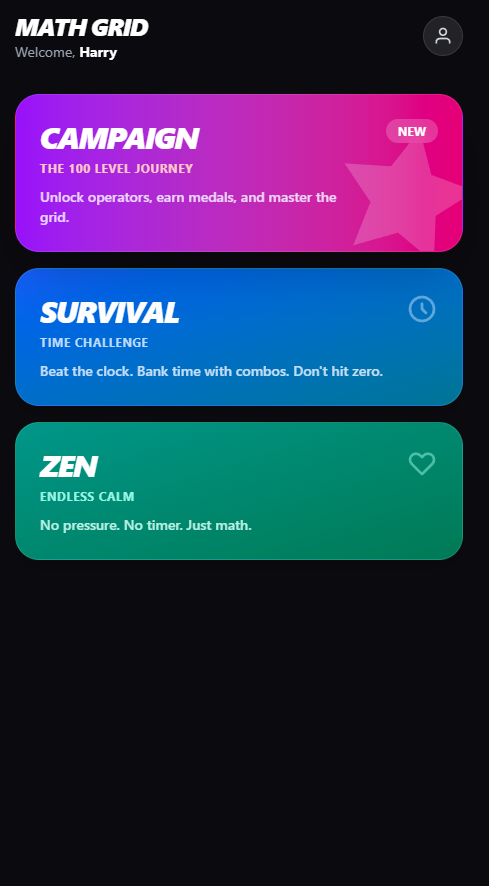
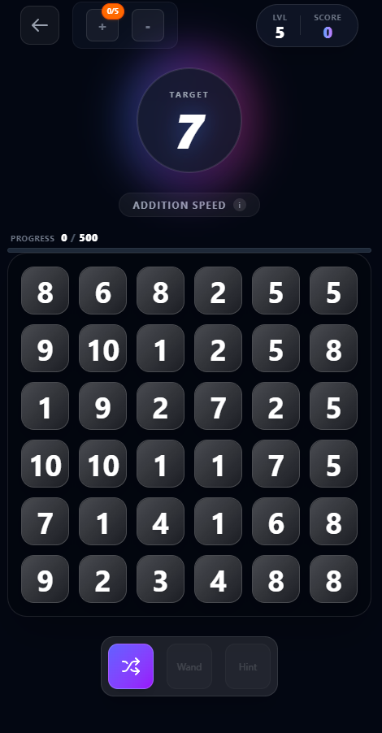
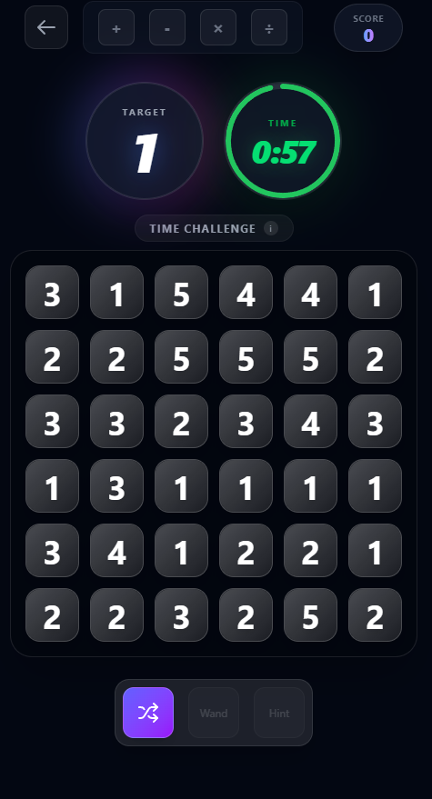
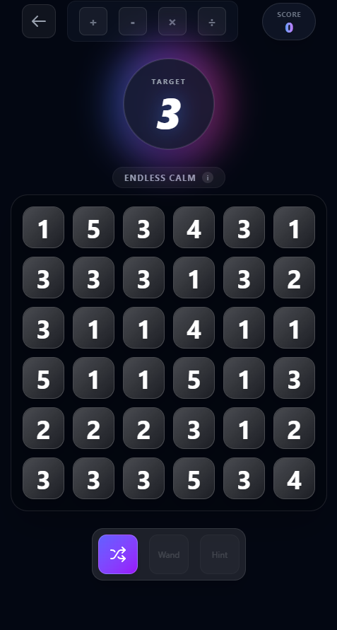
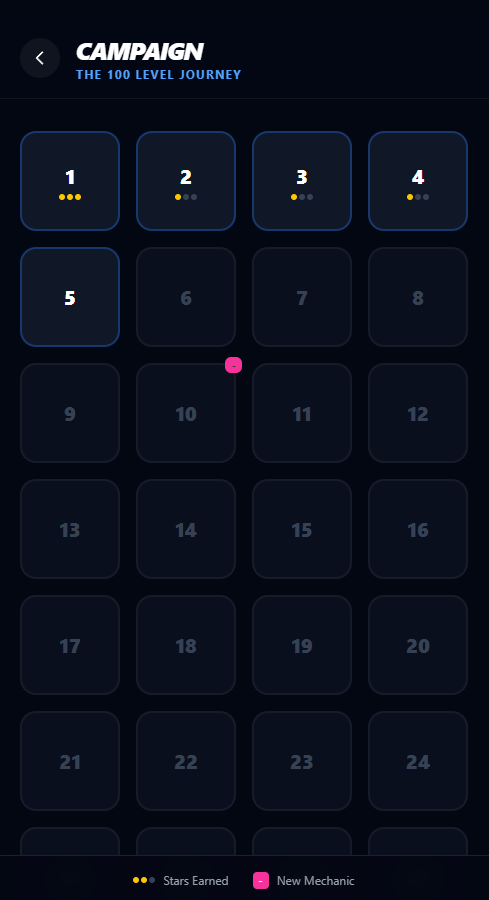
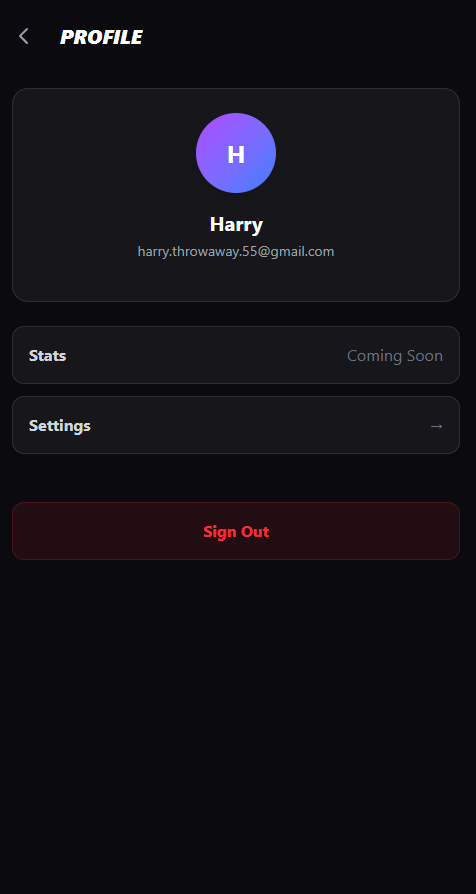
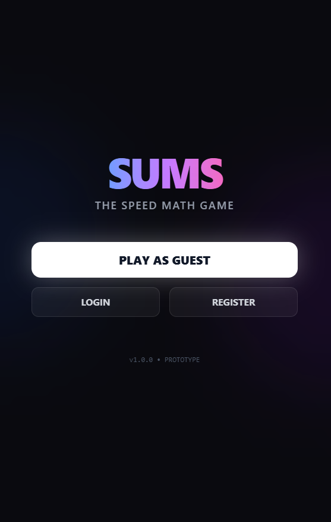

# 🧮 SUMS - The Speed Math Game

> **Note:** "SUMS" is a working title. Final name TBD!

A fast-paced math puzzle game where players select tiles that combine to reach target numbers. Built with **React**, **TypeScript**, **Vite**, and **Firebase**.



## 🎮 Game Modes

### 🏆 Campaign Mode
Progress through **100 levels** of increasing difficulty. Unlock new operators (+, -, ×, ÷), earn stars, and master your math skills.

### ⏱️ Survival Mode  
Race against the clock! Start with limited time and earn bonus seconds with each correct answer. Chain combos for extra time.

### 🧘 Zen Mode
No timer, no pressure. Just pure math practice at your own pace.

## ✨ Features

- **Progressive Difficulty** - Levels introduce new operators and larger numbers
- **Star Rating System** - Earn 1-3 stars based on speed and accuracy
- **Combo System** - Chain correct answers for bonus time in Survival mode
- **Career Analytics** - Track equations solved, time played, operator mastery
- **Account Linking** - Play as guest, then link email/Google to save progress
- **Offline Support** - LocalStorage backup with Firebase sync
- **Mobile-First Design** - Optimized for touch devices (iOS/Android ready)
- **Auto-Save** - Progress saved every 30 seconds and on tab switch

## 🛠️ Tech Stack

| Technology | Purpose |
|------------|---------|
| React 18 | UI Framework |
| TypeScript | Type Safety |
| Vite | Build Tool |
| Tailwind CSS | Styling |
| Framer Motion | Animations |
| Firebase Auth | Authentication |
| Firestore | Cloud Database |
| Claude Opus 4.5 | AI Pair Programming |
| Gemini 3 Pro | AI Pair Programming |
| Google Antigravity | IDE |

## 🚀 Getting Started

### Prerequisites
- Node.js 18+
- npm or yarn

### Installation

```bash
# Clone the repository
git clone https://github.com/harrycheese/MathGame.git
cd MathGame

# Install dependencies
npm install

# Create .env file with your Firebase config
cp .env.example .env.local

# Start development server
npm run dev
```

### Environment Variables

Create a `.env.local` file:
```env
VITE_FIREBASE_API_KEY=your_api_key
VITE_FIREBASE_AUTH_DOMAIN=your_auth_domain
VITE_FIREBASE_PROJECT_ID=your_project_id
VITE_FIREBASE_STORAGE_BUCKET=your_storage_bucket
VITE_FIREBASE_MESSAGING_SENDER_ID=your_sender_id
VITE_FIREBASE_APP_ID=your_app_id
VITE_FIREBASE_MEASUREMENT_ID=your_measurement_id
```

## 📱 Screenshots

### Gameplay

| Campaign Mode | Survival Mode | Zen Mode |
|:-------------:|:-------------:|:--------:|
|  |  |  |

### Screens

| Level Select | Profile | Login |
|:------------:|:-------:|:-----:|
|  |  |  |

## 🗺️ Roadmap

- [x] Player stats & analytics (Career stats, operator mastery, session tracking)
- [ ] Sound effects & haptic feedback
- [ ] Daily challenges
- [ ] Leaderboards
- [ ] More game modes

## 📄 License

MIT License - feel free to use this project for learning or your own apps!

---

Made with ❤️ and lots of ☕
